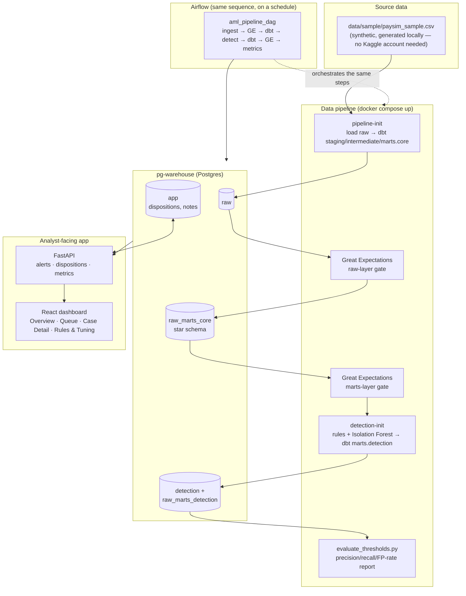
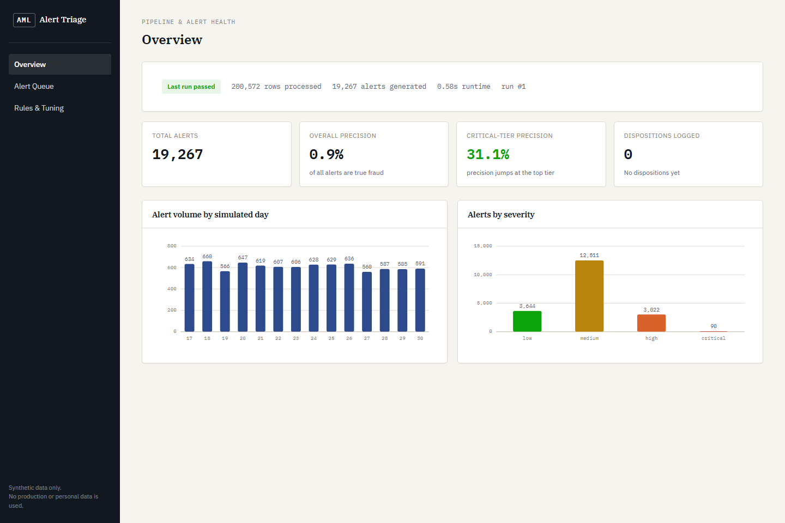
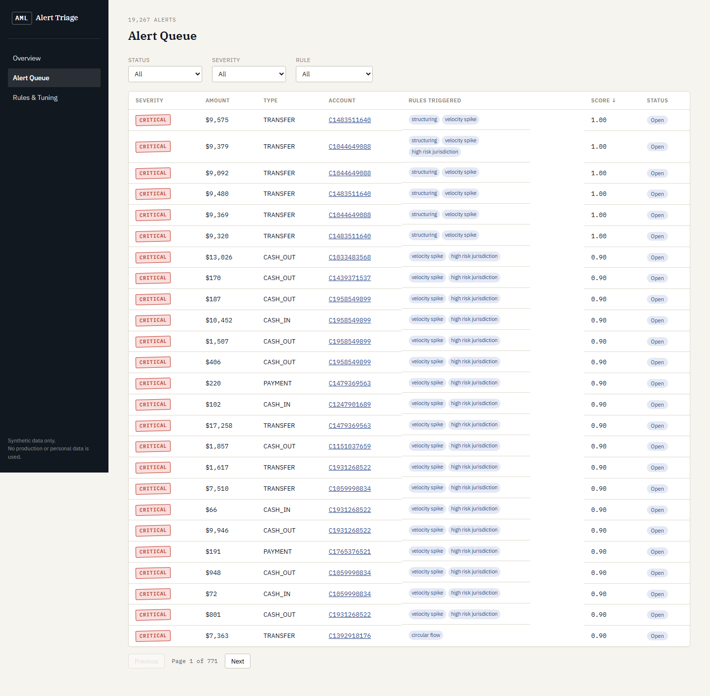
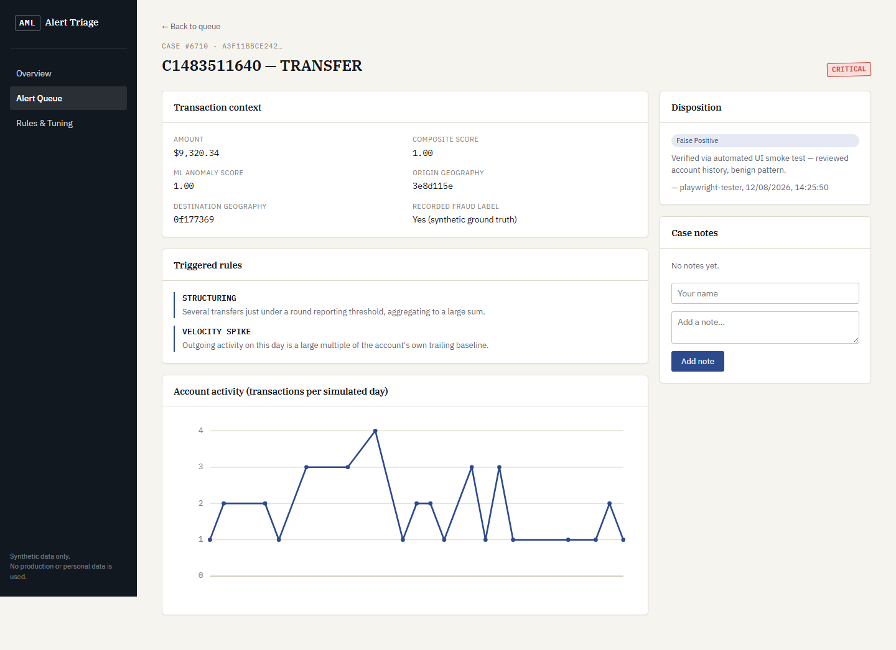
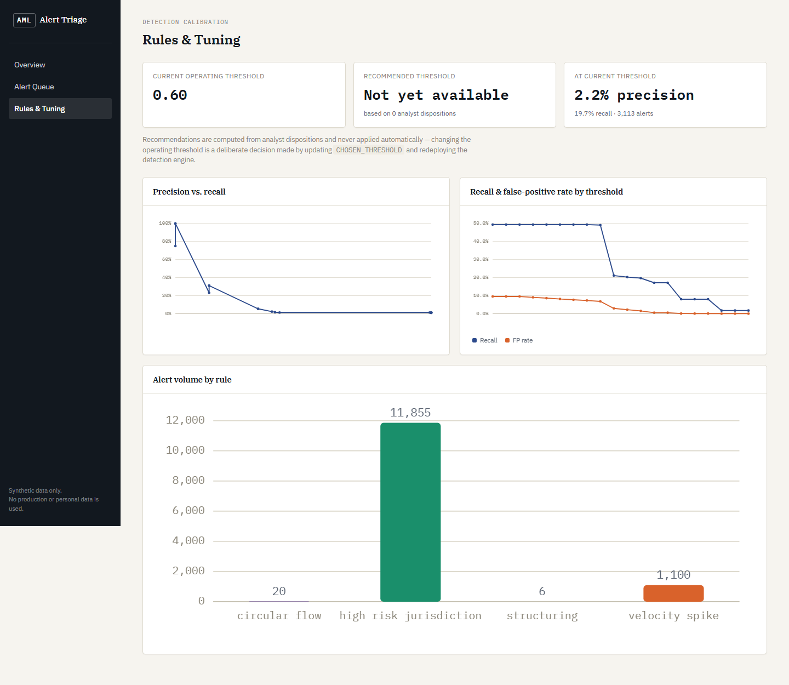

<!-- markdownlint-disable MD033 -->
# AML Transaction Monitoring & Alert Triage Platform

A hybrid rules + machine-learning transaction monitoring pipeline and analyst alert-triage
platform, built end to end: ingestion, a documented star schema, data-quality gates, detection,
a REST API, and a custom-designed analyst dashboard — orchestrated by Airflow and runnable
with one command.

[](https://github.com/OWNER/REPO/actions/workflows/ci.yml)
[](https://github.com/OWNER/REPO/actions/workflows/codeql.yml)

> Badge URLs use an `OWNER/REPO` placeholder until this repo is pushed to GitHub — swap in the
> real path once it has a remote (see [What's next](#whats-next)).

## The problem

AML transaction monitoring systems are notorious for burying analysts in false positives —
the industry-wide false-positive rate is commonly cited north of 90%. A rules-only engine
makes this worse: every alert looks equally urgent, there's no feedback loop from analyst
decisions back into tuning, and compliance leadership has no visibility into whether the
control is actually working. Singapore's DTSP licensing regime (in force since 30 June 2025,
requiring a locally based compliance officer) has driven real hiring demand for people who can
build and operate exactly this kind of system.

This project builds the system: a hybrid detection engine that combines deterministic rules
with an Isolation Forest anomaly model into one explainable, severity-tiered alert, plus the
triage tooling an analyst and a compliance lead actually need — not just a model in a notebook.

## Architecture



**Two Postgres instances, not one** — `pg-airflow` holds only Airflow's own scheduling state;
`pg-warehouse` holds the analytics warehouse and app state. See
[ADR-0001](docs/adr/0001-two-postgres-containers.md) for why.

## Tech stack

| Layer | Technology |
|---|---|
| Orchestration | Apache Airflow (LocalExecutor) |
| Transformation | dbt-core + dbt-postgres, star schema across staging → intermediate → marts |
| Data quality | Great Expectations, gating both the raw and marts layers |
| Detection | Deterministic rules (pandas) + scikit-learn Isolation Forest |
| Warehouse | PostgreSQL 16 |
| API | FastAPI + SQLAlchemy |
| Frontend | React + TypeScript (Vite), TanStack Query, custom SVG charts, no charting library |
| Testing | pytest (detection + API), Vitest + React Testing Library (frontend) |
| CI/CD | GitHub Actions (lint, typecheck, unit + integration tests, CodeQL) |
| Containerization | Docker Compose, one command for the full stack |

## Run it in one command

```bash
git clone <this-repo>
cd aml-transaction-monitoring
cp .env.example .env
docker compose up
```

Then open:
- **Dashboard:** http://localhost:5173
- **API docs:** http://localhost:8000/docs
- **Airflow UI:** http://localhost:8080 (`admin` / `admin`)

No Kaggle account or external data download is required — `scripts/generate_paysim_sample.py`
already produced the committed synthetic dataset (see
[ADR-0004](docs/adr/0004-synthetic-paysim-generation-over-download.md)). On first run,
`pipeline-init` loads the data and builds the star schema, then `detection-init` runs the
detection engine and populates alerts — both complete automatically before the API and
frontend start serving, so the dashboard has real data the first time you load it. Expect
roughly 60–90 seconds end to end on a cold start (image builds are cached after the first run).

To see the same pipeline run under Airflow's own scheduling instead of the one-shot bootstrap,
unpause and trigger `aml_pipeline_dag` from the Airflow UI.

## Screenshots

**Overview** — pipeline health, alert volume, severity breakdown:


**Alert Queue** — severity-sorted, filterable by status/severity/rule:


**Case Detail** — triggered-rule explanations, account history, disposition capture:


**Rules & Tuning** — precision/recall curve, disposition-driven threshold recommendation:


## Metrics

From the current evaluation run (full sweep and chart in
[`docs/metrics/latest_evaluation_report.md`](docs/metrics/latest_evaluation_report.md)):

| Metric | Value |
|---|---|
| Rows processed | 200,572 |
| Alerts generated | 19,267 |
| Pipeline runtime (detection scoring) | ~48s |
| dbt build + test runtime | ~10s |
| Great Expectations pass rate | 100% (13/13 raw, 10/10 marts) |
| Overall precision (unfiltered) | 0.9% |
| Overall recall (unfiltered) | 49.4% |
| Precision at chosen threshold (0.60) | 2.2% |
| Recall at chosen threshold (0.60) | 19.7% |
| False-positive rate at chosen threshold | 1.5% (vs. 9.5% unfiltered) |
| **Precision at `critical` severity tier** | **31.1%** |
| Precision at `high` / `medium` / `low` tiers | 1.4% / 0.8% / 0.0% |

The headline result isn't a single precision number — it's that severity tiering turns a
0.9%-precision firehose into a 31%-precision top tier, which is the actual mechanism that makes
analyst triage tractable. Full per-rule breakdown, the precision/recall curve, and the FP-rate
trade-off are in the linked report.

**Interview question this project is built to answer:** *"Your model flags 400 alerts a day and
analysts can review 50. What do you change?"* — see the Rules & Tuning page: severity-tier the
alerts, work `critical` first, and let analyst dispositions (once ≥5 are logged) drive a
recommended threshold instead of guessing.

## Testing

```bash
# detection engine unit tests (22 tests, no DB required)
docker compose run --rm detection-init python -m pytest detection/tests -v

# API tests (13 tests, integration-style against the real warehouse)
docker compose run --rm api python -m pytest tests -v

# frontend tests (10 tests)
cd frontend && npm test
```

All three suites, plus the full pipeline bootstrap, run in CI on every push — see
[`.github/workflows/ci.yml`](.github/workflows/ci.yml).

## Repository layout

| Path | Purpose |
|---|---|
| `scripts/generate_paysim_sample.py` | Synthetic PaySim-schema dataset generator |
| `dbt/` | Star schema: staging → intermediate → marts.core / marts.detection |
| `great_expectations/` | Data-quality suites (raw + marts gates) |
| `detection/` | Rules engine, Isolation Forest, score combination, evaluation |
| `airflow/dags/` | The orchestration DAG |
| `api/` | FastAPI backend |
| `frontend/` | React + TypeScript dashboard |
| `docs/adr/` | Architecture decision records |
| `docs/ba/` | Process map, user stories, PRD |
| `docs/metrics/` | Generated evaluation report |

## Security

- No secrets committed — `.env.example` documents every variable, `.env` is gitignored.
- [`.github/dependabot.yml`](.github/dependabot.yml) covers all five Python subprojects, npm,
  Docker, and GitHub Actions on a weekly schedule.
- [`.github/workflows/codeql.yml`](.github/workflows/codeql.yml) runs free CodeQL analysis for
  Python and TypeScript on every push/PR and weekly.
- GitHub secret scanning + push protection should be enabled in repo settings once this is
  pushed (free on public repos) — not something a local checkout can turn on itself.

## Synthetic data disclaimer

All data in this repository — transactions, account identifiers, jurisdictions, and detection
results — is synthetically generated. No production or personal data is used anywhere in this
project. See [`data/sample/DATA_DICTIONARY.md`](data/sample/DATA_DICTIONARY.md) and
[ADR-0004](docs/adr/0004-synthetic-paysim-generation-over-download.md) for exactly how and why.

## What's next

- **Live deployment.** [ADR-0005](docs/adr/0005-split-local-pipeline-vs-hosted-demo.md)
  documents the intended split (Vercel + Render + Neon, kept fresh by a scheduled GitHub
  Action) — not yet stood up. The full stack is fully demoable locally via `docker compose up`
  in the meantime.
- **Stable alert identity across pipeline runs.** Alerts are currently regenerated with fresh
  IDs on every full-refresh detection run, so analyst dispositions don't durably survive a
  re-run — see the consequence noted in
  [ADR-0002](docs/adr/0002-full-refresh-over-incremental-ingestion.md). The fix is a stable
  natural key (e.g. transaction + rule set) instead of a regenerated surrogate one.
- **Incremental, checkpoint-based ingestion** once this runs against a live, growing source
  rather than a fixed synthetic file (ADR-0002).
- **A comparison supervised model** (trained on the synthetic ground-truth labels) benchmarked
  against the current hybrid engine, to make the trade-off in ADR-0003 empirical rather than
  argued.
- **Real sanctions/watchlist data** in place of the synthetic geography risk seed, if this were
  ever adapted beyond a portfolio demo.
