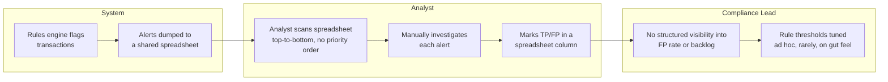
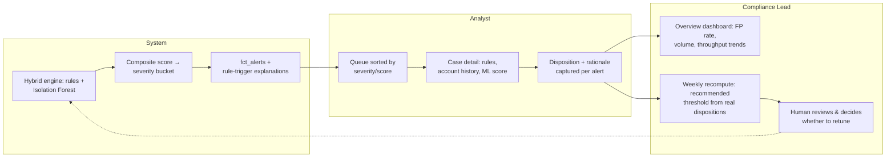

# Alert Triage Process Map: As-Is → To-Be

## As-Is: rules-only, manual triage

Before the hybrid engine and structured triage queue, the process an AML
operations team runs looks like this:

**Pain points:**
- No severity ordering — analysts work whatever's at the top of the sheet, not
  whatever's riskiest.
- Dispositions live in a spreadsheet column, disconnected from the alert's
  original context (which rule fired, the transaction amount, account history).
- No feedback loop: rule thresholds are tuned from memory and intuition, not
  from actual disposition outcomes.
- No visibility into the false-positive rate or analyst throughput — the
  operational pain (alert fatigue) is invisible until someone complains.

## To-Be: hybrid scoring, prioritized queue, closed feedback loop

**What changed:**
- **Prioritization**: alerts are severity-bucketed from a composite score, so
  `critical` (31%+ precision) gets worked before `low` (0% precision in the
  current evaluation — see `docs/metrics/latest_evaluation_report.md`).
- **Context at the point of decision**: case detail shows exactly which
  rule(s) fired and why, plus account transaction history, so a disposition
  rationale is grounded in specifics rather than reconstructed from memory.
- **Structured, auditable dispositions**: `app.alert_dispositions` — one
  disposition per alert, immutable once submitted, always paired with a
  rationale.
- **Closed feedback loop**: `recompute_from_dispositions.py` turns analyst
  decisions back into a *recommended* threshold — surfaced to a human on the
  Rules & Tuning page, never auto-applied (see ADR-0003).
- **Visibility for compliance leadership**: the Overview dashboard makes the
  FP rate, alert volume trend, and analyst throughput a first-class, always-on
  view instead of something inferred from a spreadsheet on request.
