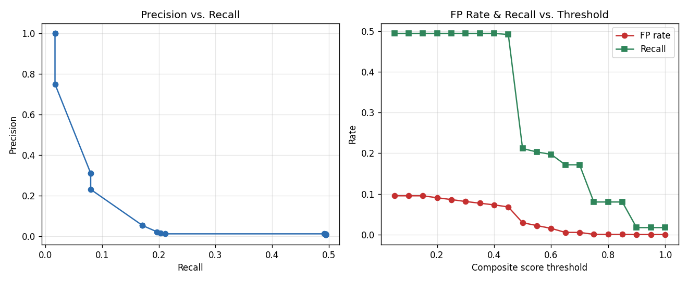

# Detection evaluation report

Generated by `detection/evaluation/evaluate_thresholds.py`. All data is synthetic (see `data/sample/DATA_DICTIONARY.md`).

- Rows processed: **200,572**
- Ground-truth fraud transactions: **350**
- Chosen operating threshold (composite score): **0.6**
- Precision at chosen threshold: **2.22%**
- Recall at chosen threshold: **19.71%**
- False-positive rate at chosen threshold: **1.518%**
- Alerts generated at chosen threshold: **3,113**

## Full threshold sweep

| Threshold | Alerts | True Positives | Precision | Recall | FP Rate |
|---|---|---|---|---|---|
| 0.05 | 19,267 | 173 | 0.90% | 49.43% | 9.520% |
| 0.1 | 19,267 | 173 | 0.90% | 49.43% | 9.520% |
| 0.15 | 19,267 | 173 | 0.90% | 49.43% | 9.520% |
| 0.2 | 18,324 | 173 | 0.94% | 49.43% | 9.050% |
| 0.25 | 17,413 | 173 | 0.99% | 49.43% | 8.595% |
| 0.3 | 16,457 | 173 | 1.05% | 49.43% | 8.119% |
| 0.35 | 15,624 | 173 | 1.11% | 49.43% | 7.704% |
| 0.4 | 14,800 | 173 | 1.17% | 49.43% | 7.293% |
| 0.45 | 13,778 | 172 | 1.25% | 49.14% | 6.784% |
| 0.5 | 5,919 | 74 | 1.25% | 21.14% | 2.914% |
| 0.55 | 4,491 | 71 | 1.58% | 20.29% | 2.204% |
| 0.6 | 3,113 | 69 | 2.22% | 19.71% | 1.518% |
| 0.65 | 1,122 | 60 | 5.35% | 17.14% | 0.529% |
| 0.7 | 1,120 | 60 | 5.36% | 17.14% | 0.528% |
| 0.75 | 121 | 28 | 23.14% | 8.00% | 0.046% |
| 0.8 | 90 | 28 | 31.11% | 8.00% | 0.031% |
| 0.85 | 90 | 28 | 31.11% | 8.00% | 0.031% |
| 0.9 | 8 | 6 | 75.00% | 1.71% | 0.001% |
| 0.95 | 6 | 6 | 100.00% | 1.71% | 0.000% |
| 1.0 | 6 | 6 | 100.00% | 1.71% | 0.000% |

